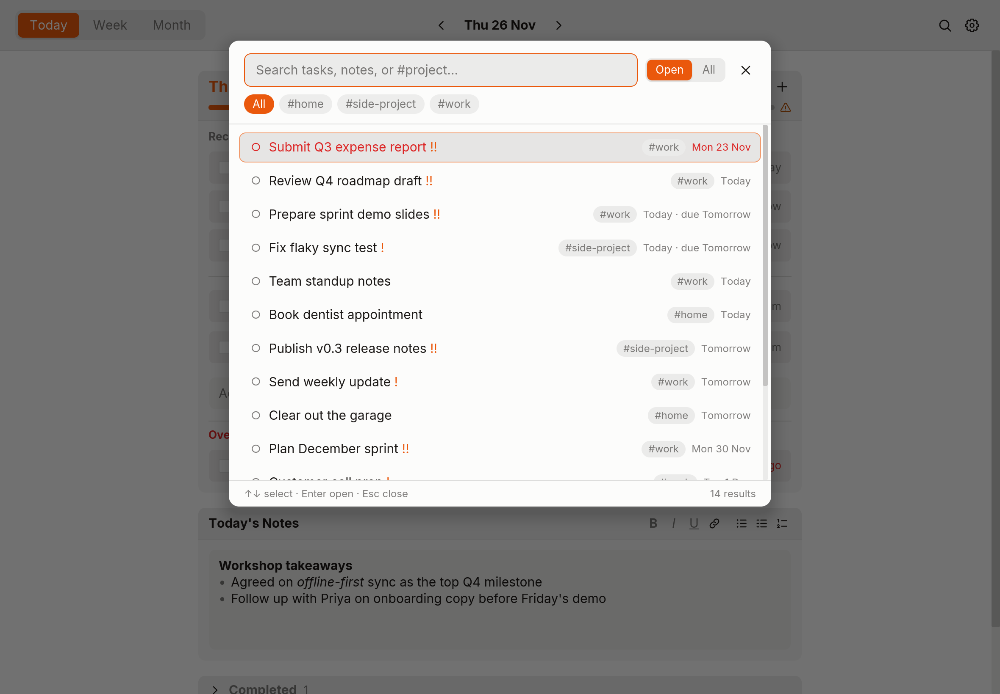

<picture>
  <source media="(prefers-color-scheme: dark)" srcset="assets/icon-dark.svg">
  
</picture>

# Fortnight

A local-first desktop task manager that helps plan your day and writes your weekly summary.

Built in Rust around a single portable SQLite folder, Fortnight works with local [Ollama](https://ollama.com) models as well as OpenAI-compatible and Anthropic endpoints. Your tasks stay on your machine, private items stay out of prompts, and the app works offline whenever you don't need a model.

*Built and tested on macOS; also builds on Windows and Linux.*

<picture>
  <source media="(prefers-color-scheme: dark)" srcset="assets/screenshots/week-dark.png">
  
</picture>

<table>
  <tr>
    <td width="50%">
      <picture>
        <source media="(prefers-color-scheme: dark)" srcset="assets/screenshots/today-dark.png">
        
      </picture>
    </td>
    <td width="50%">
      <picture>
        <source media="(prefers-color-scheme: dark)" srcset="assets/screenshots/month-dark.png">
        
      </picture>
    </td>
  </tr>
  <tr>
    <td><strong>Today</strong>: ranked focus list, quick add, overdue tasks, and daily notes.</td>
    <td><strong>Month</strong>: calendar overview with daily completion rates and weekly summary markers.</td>
  </tr>
</table>

## Highlights

- **Today, Week, and Month views.** Work through today's list and rich daily notes, balance your week with per-day capacity bars and drag-and-drop scheduling, or zoom out to a monthly calendar.
- **Daily focus list.** Fortnight ranks up to three tasks to tackle first based on priority, deadlines, and your schedule, refreshing automatically as things change.
- **Weekly summaries from real history.** Because every task change and daily note is logged locally, your weekly recap covers what actually shipped, slipped, or went overdue, ready to edit inline or copy as Markdown.
- **Local-first and private.** Everything lives in one portable `fortnight-data/` folder. API keys are encrypted on disk with Argon2id + XChaCha20-Poly1305 (or skipped altogether for local Ollama), and private tasks never touch an LLM.
- **Keyboard-driven with a companion CLI.** Natural quick-add syntax, instant search (`/` or `Cmd/Ctrl+F`), single-key navigation, full undo/redo, and a headless CLI sharing the same live database.

## Quick add & search

Type a task with inline tokens anywhere in the quick-add bar:

```text
Write Q4 report wed due:fri #work ~2h ! every:weekly
```

| Token | Sets | Examples |
|---|---|---|
| `<date>` | Planned day | `fri`, `tomorrow`, `nov 20`, `+3d` |
| `due:<date>` | Deadline | `due:fri`, `due:+5d`, `due:2026-11-20` |
| `#name` | Project | `#work` |
| `~time` | Time estimate | `~30m`, `~2h`, `~1h30m` |
| `!`, `!!`, `!!!` | Priority (`!` is highest) | `!` |
| `every:<cadence>` | Recurrence on completion | `every:daily`, `every:weekdays`, `every:weekly`, `every:monthly` |

Tasks also support subtasks, notes, a private flag, and live priority suggestions as you type. Hit `/` or `Cmd/Ctrl+F` to search across tasks and daily notes or filter by `#project`.

<picture>
  <source media="(prefers-color-scheme: dark)" srcset="assets/screenshots/search-dark.png">
  
</picture>

<details>
<summary>Keyboard shortcuts (press <code>?</code> in-app anytime)</summary>

| Key | Action |
|---|---|
| `1` `2` `3` | Today, Week, Month |
| `←` `→` | Previous / next day, week, or month |
| `T` | Jump to today |
| `N` or `Cmd/Ctrl+N` | Focus quick-add bar |
| `/` or `Cmd/Ctrl+F` | Search and filter by project |
| `↑` `↓` | Move selection in Today or Search |
| `Space` | Toggle task complete |
| `Enter` | Edit selected task |
| `Cmd/Ctrl+Z` / `Shift+Cmd/Ctrl+Z` | Undo / redo |
| `Cmd/Ctrl+,` | Open Settings |
| `?` | Shortcut sheet |

</details>

## Install

Build from source with [Rust](https://rustup.rs) (`rust-toolchain.toml` pins the toolchain automatically):

- **macOS:** Xcode Command Line Tools (`xcode-select --install`)
- **Windows:** [Visual Studio Build Tools](https://visualstudio.microsoft.com/visual-cpp-build-tools/) with "Desktop development with C++"
- **Linux:** a C compiler

```sh
git clone https://github.com/CwbhX/fortnight.git
cd fortnight
cargo build --release --locked
./target/release/Fortnight        # Windows: target\release\Fortnight.exe
```

To package a macOS `.app` bundle at `target/bundle/Fortnight.app`:

```sh
cargo xtask bundle                # native architecture
cargo xtask bundle --universal    # Apple Silicon + Intel (requires both rustup targets)
```

## Model setup

Open **Settings** (`Cmd/Ctrl+,`) to pick an endpoint:

- **Ollama (local, zero setup):** Running Ollama on `localhost:11434` (or `OLLAMA_HOST`) is detected automatically, with no API key or password needed. Ollama 0.35+ decision models (`/v1/systemone`) are also supported for recommendations and priority suggestions.
- **OpenAI-compatible & Anthropic:** Enter your URL and API key, then set a password to encrypt the key on disk. Use the lock icon in the top bar anytime to unlock or wipe keys from memory.
- **Separate recommendations model:** Optionally assign a faster or local model specifically for Today's focus list under **Recommendations**.

Settings also covers themes, accent colors, working days and daily hours (for Week load bars), custom prompts, and one-click Markdown/JSON export.

## Data & privacy

All app state stays in one `fortnight-data/` folder next to the binary or `.app` bundle (override with `--data-dir <path>` or `FORTNIGHT_DATA_DIR`):

```text
fortnight-data/
├── fortnight.db        # SQLite database: tasks, history, summaries, settings
├── llm-key             # Encrypted API key (created only when needed)
├── llm-key-decision    # Encrypted Recommendations key (optional)
└── fortnight.lock      # Active-instance lock for the desktop app
```

Moving or backing up Fortnight is just copying that folder. If you place it in iCloud or Dropbox, keep the desktop app open on only one machine at a time. API keys are sealed with XChaCha20-Poly1305 (keyed via Argon2id) and sent only over HTTPS or to localhost; if you forget your password, clear and re-enter them in Settings.

## CLI

`fortnight-cli` works directly on the same database without opening a window, and the desktop app picks up changes automatically:

```sh
fortnight-cli add [--private] <quick-add text...>
fortnight-cli list [--all] [--today] [--week] [--project <name>]
fortnight-cli done <id>... [--undo]
fortnight-cli edit <id> [options]        # see `fortnight-cli edit --help`
fortnight-cli delete <id>... [--forever]
fortnight-cli log [--task <id>] <text...>
fortnight-cli summary [--week this|last|YYYY-MM-DD] [--facts]
fortnight-cli plan [--facts]
fortnight-cli run-due
fortnight-cli export [--format md|json] [--out <path>]
```

Pass `--data-dir <path>` anywhere to target another folder (handy alongside `Fortnight.app`). For `summary`, `plan`, and `run-due`, `--facts` prints what would be sent without calling a model, and endpoint settings can be overridden via flags (`--protocol`, `--base-url`, `--model`, `--keyless`, `--password-stdin`) or environment variables.

<details>
<summary>Environment variables</summary>

**CLI overrides** (flags override env vars, which override saved settings):

| Variable | Purpose |
|---|---|
| `FORTNIGHT_DATA_DIR` | Data folder path (`--data-dir` overrides) |
| `FORTNIGHT_LLM_PROTOCOL` | `openai` or `anthropic` |
| `FORTNIGHT_LLM_BASE_URL` | Endpoint URL (e.g. `http://localhost:11434/v1`) |
| `FORTNIGHT_LLM_MODEL` | Model name |
| `FORTNIGHT_LLM_KEYLESS` | Set to `1` if no API key is required |
| `FORTNIGHT_LLM_API_KEY` | One-off API key (never written to disk) |
| `FORTNIGHT_DECISION_API_KEY` | One-off Recommendations API key |

**Development helpers** (desktop app):

| Variable | Purpose |
|---|---|
| `FORTNIGHT_PAGE` | Start on `today`, `week`, `month`, `settings`, or `search` |
| `FORTNIGHT_OPEN_SUMMARY` | `1` to expand Weekly Summary on launch |
| `FORTNIGHT_THEME` | Force `light` or `dark` |
| `FORTNIGHT_SCREENSHOT` | Save a raw RGBA window capture after delay and quit (`python3 -I tools/raw2png.py <raw> out.png`) |
| `FORTNIGHT_SCREENSHOT_DELAY` | Capture delay in seconds (default `2`) |
| `FORTNIGHT_MOTION` | Hold animations at progress `0`..`1` |

</details>

## Development

```sh
cargo fmt --check
cargo clippy --all-targets -- -D warnings
cargo test
```

Workspace crates: `crates/fortnight-core` (storage, task logic, summaries, LLM clients), `crates/fortnight-app` (`iced` GUI), `crates/fortnight-cli`, and `xtask` (macOS bundling). To try the UI with sample data, copy `crates/fortnight-core/tests/fixtures/round1.db` into a scratch directory as `fortnight.db` and launch with `--data-dir`.

## License

MIT ([LICENSE](LICENSE)). Built by [Clement Hathaway](https://github.com/CwbhX) with [T3 Code](https://t3.codes).
