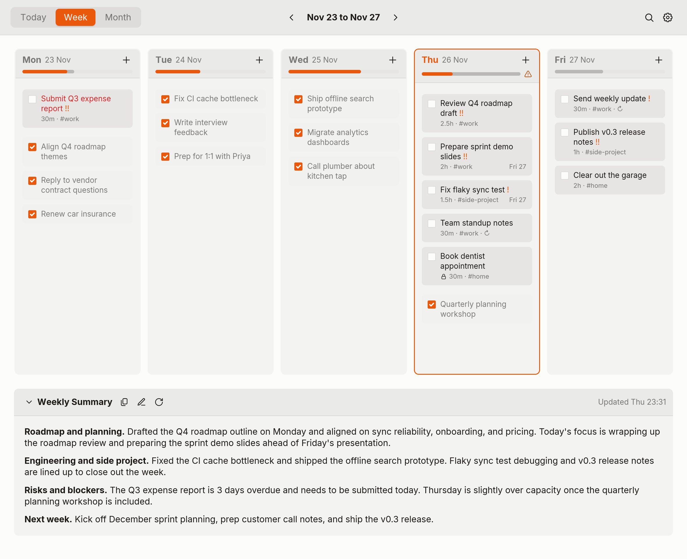
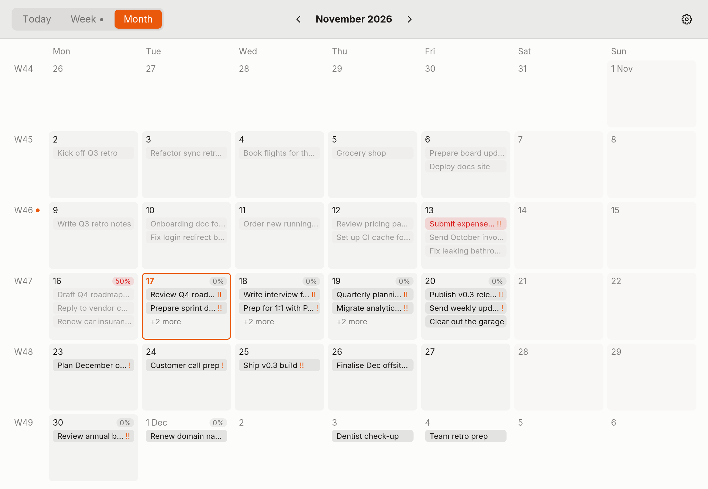

<picture>
  <source media="(prefers-color-scheme: dark)" srcset="assets/icon-dark.svg">
  
</picture>

# Fortnight

Fortnight is a portable todo app. It keeps your tasks and their history in a SQLite file on your machine. It sends that history to an LLM endpoint you choose, which writes a summary of your week and recommends what to work on next. Nothing else leaves your machine. It is built and tested on macOS. [PLAN.md](PLAN.md) is the original design document, kept for history.

Created in [T3 Code](https://t3.codes).

<picture>
  <source media="(prefers-color-scheme: dark)" srcset="assets/screenshots/week-dark.png">
  
</picture>

<table>
  <tr>
    <td width="50%"></td>
    <td width="50%"></td>
  </tr>
  <tr>
    <td>Today: recommended tasks, overdue tasks in red, and quick add.</td>
    <td>Month: every task in the month, with the share done on each day.</td>
  </tr>
</table>

## Quick start

1. Install Rust from [rustup.rs](https://rustup.rs). On macOS, also run `xcode-select --install`. On Windows, also install the [Visual Studio Build Tools](https://visualstudio.microsoft.com/visual-cpp-build-tools/) with the "Desktop development with C++" workload.
2. Get the code and build it:

   ```
   git clone https://github.com/CwbhX/fortnight.git
   cd fortnight
   cargo build --release --locked
   ```

   The first build downloads the pinned Rust version and every dependency, and takes a few minutes.
3. Start the app:

   ```
   ./target/release/Fortnight
   ```

   On Windows, run `target\release\Fortnight.exe`. On macOS you can run `cargo xtask bundle` instead, which makes `target/bundle/Fortnight.app`.

Your data goes in a `fortnight-data` folder beside the program, here `target/release/fortnight-data`. To keep it somewhere else, start the app with `--data-dir <folder>`. To set up the LLM, see [First run](#first-run).

## What it does

- Three tabs show the same tasks around one selected date. `‹` and `›` move by a day, a week or a month, and Today jumps back.
  - Today lists recommended tasks, the day's tasks, overdue tasks, notes, completed tasks, a collapsed No date inbox and a collapsed Deleted section. Drag a task card to reorder the Tasks section. Deleted holds every deleted task with Restore and Delete forever on each card, and Delete all in its header. A done task shows on the day it was planned for.
  - Week has a column per working day. Each column title bar has a load bar: estimated tasks take their estimate, tasks without one share the rest of the day, and done tasks are drawn in the accent colour. Hover it for the figures. A warning sign shows when estimates exceed the day's capacity. Drag a task card to another day or to a new place in its day. The Work Summary is below the columns.
  - Month is a calendar. A day with tasks due shows the share that is done, such as `67%`; click it to list those tasks. Click a day to open it, or a week label to open that week.
- One quick-add bar is always visible. `Write Q4 report fri #work ~2h !` creates a task planned for Friday in project `work`, estimated at two hours, with priority 1. Dates can be `fri`, `tomorrow`, `nov 20` or `+3d`. Estimates can be `~2h`, `~30m` or `~1h30m`. `!`, `!!` and `!!!` set the priority, and cards show it as marks after the title.
- A task has notes, an estimate, a priority, a planned day, a deadline and a status of to do, done or deleted. While you type a title or notes in a task form, the app suggests a priority.
- Today's Notes is a free-text box. Notes can be written on any day. Each day's notes are stored as one log line and go into the weekly summary.
- Every change to a task is recorded. The weekly summary uses that history and your notes to say what you finished, what progressed, which deadlines moved and what is overdue. It is shown as Work Summary, with a copy icon in its header.
- Recommended tasks are the top three open tasks, numbered, at the top of Today. Rust does the counting; the model picks the order. On today the list covers the day's tasks and all overdue tasks. On a later day it covers only the tasks planned for that day. Priority and lateness raise a task's rank. The list updates when tasks change.
- The Work Summary updates on its own: when you open the Week tab, anything changed since the last update is sent once. After you edit on the Week tab, the summary reruns after 30 seconds. The previous result stays on screen until the new one is done. Both system prompts can be changed in Settings.
- From 16:00 on your last working day (Friday by default) the summary is also kept up to date in the background. Fortnight checks at launch and every minute. A dot on the Week tab says when a background update is ready.
- Settings has a Model block and a Recommendations block. Recommendations uses the Model block unless you tick Use a different model. Each block has a provider, a URL, a model and, except for Ollama, an API key. The provider is Ollama, OpenAI-compatible or Anthropic. Test checks the connection.
- A local Ollama is detected at launch and when Settings opens, at `http://localhost:11434/v1` or the address in `OLLAMA_HOST`. Its models are listed with a thinking or decision tag. A decision model needs Ollama 0.35 or later and uses `/v1/systemone`. It answers with choices and probabilities, and is offered only for Recommendations. It also suggests task priorities. If it fails, Recommendations falls back to the Model endpoint.
- An endpoint that needs no key, such as Ollama, has no key controls and never asks for a password.
- Each API key is stored encrypted under one password. Click the lock icon in the top bar to unlock the keys into memory; click again to lock, which wipes them and stops any request that holds one. The app works while locked; only the LLM features wait.
- Settings sets the first day of the week (Sunday by default), the working days and the work hours per day (8 by default). The load bars use the last two. Settings also holds the theme (match the system, light or dark), the accent colour, the app icon and, folded at the bottom, the prompts.
- Cmd+Z or Ctrl+Z undoes the last add, status change, edit or delete.
- `fortnight-cli export` writes tasks, history and reports to Markdown or JSON.

### Keyboard

Single keys work when no text field has focus. Press Escape to leave a text field.

| Key | Action |
|---|---|
| `1` `2` `3` | Today, Week, Month |
| `←` `→` | Previous or next day, week or month |
| `T` | Jump to today |
| `N` or `Ctrl/Cmd+N` | Focus the quick-add bar |
| `↑` `↓` | Move the selection in Today |
| `Space` | Mark the selected task done or not done |
| `Enter` | Open the selected task for editing |
| `Ctrl/Cmd+,` | Settings |
| `Ctrl/Cmd+Z` | Undo the last change |

## Build and run

You need Rust from [rustup](https://rustup.rs). `rust-toolchain.toml` pins the compiler version, and rustup installs it on first build.

| Platform | Also needs |
|---|---|
| macOS | The Xcode command-line tools: `xcode-select --install` |
| Windows | The MSVC build tools. The C runtime is linked statically, so the built program needs nothing installed. |
| Linux | A C compiler. SQLite is built from bundled source. The program loads the window system and graphics libraries at run time, and every desktop install has them. |

```
cargo build --release --locked
./target/release/Fortnight        # the app, Fortnight.exe on Windows
./target/release/fortnight-cli    # the command-line tool
```

`cargo run --release -p fortnight-app` builds and starts the app in one step.

### Fortnight.app on macOS

```
cargo xtask bundle              # for this Mac's architecture
cargo xtask bundle --universal  # for Apple Silicon and Intel
```

This builds the app and wraps it in `target/bundle/Fortnight.app`, so it starts without a terminal window. It replaces any existing bundle. `--universal` needs both Rust targets, which `rustup target add aarch64-apple-darwin x86_64-apple-darwin` installs. The icon is made from `assets/icon-light.svg` with tools that come with macOS. If that fails, the bundle has no icon. You can move `Fortnight.app` anywhere; keep the data folder beside it. `fortnight-cli` is not in the bundle and uses the folder beside itself, so give it `--data-dir` to share the app's.

## Where your data lives

Everything is in one folder, `fortnight-data`, beside the program:

```
anywhere/
├── Fortnight            or Fortnight.exe, or Fortnight.app
└── fortnight-data/
    ├── fortnight.db     tasks, history, reports and settings, in a standard SQLite file
    ├── llm-key          your API key, encrypted, if you set one
    ├── llm-key-decision the Recommendations key, encrypted, if you set one
    └── fortnight.lock   present while the app has the folder open
```

Fortnight picks the folder in this order:

1. `--data-dir <path>`.
2. The `FORTNIGHT_DATA_DIR` environment variable, if it isn't empty.
3. `fortnight-data` beside the program. For `Fortnight.app`, the folder goes beside the `.app`, because writing inside a bundle would break its signature.

Fortnight writes nothing outside this folder. To move your data, copy the folder. A folder from an earlier version opens with nothing lost; Fortnight upgrades the database in place the first time.

The app creates `fortnight.lock` while it runs and removes it on exit. If the folder is in a synced directory such as Dropbox or iCloud, open it on one machine at a time. The app warns if it finds a lock from another machine. The CLI never takes the lock, so it can run while the app is open. The app rereads tasks only at launch and after a change made in it, so a task the CLI adds or completes shows up there after your next change or a restart.

`llm-key` and `llm-key-decision` hold your API keys, sealed with XChaCha20-Poly1305 under a key that Argon2id derives from your password. Someone who copies the data folder can't read the keys. While the app is unlocked the keys are in memory, where other software running as you could read it. `fortnight.db` is not encrypted. A forgotten password can't be recovered, so remove the keys in Settings and enter them again. If your endpoints need no key, as a local Ollama doesn't, Fortnight never creates the files and never asks for a password.

Fortnight sends each key only to its configured endpoint. It refuses to send it over plain `http` to another machine, and it doesn't follow redirects.

## First run

1. Start the app and open Settings with the gear or `Cmd+,`.
2. In Model, choose the provider and enter the URL and model. Load lists what the endpoint offers. If Ollama is running, it is chosen with its first chat model.
3. If the endpoint needs a key, paste it and press Save, then choose a password. The password encrypts the key on disk; unlock it with the lock icon.
4. Press Test.
5. To use another model for Recommendations, tick Use a different model in that block and repeat steps 2 to 4. A decision model from Ollama needs no key.
6. Press Save at the top of Settings.

## Environment variables

| Variable | Meaning |
|---|---|
| `FORTNIGHT_DATA_DIR` | The data folder. `--data-dir` takes precedence. |
| `FORTNIGHT_LLM_PROTOCOL` | `openai` or `anthropic`. |
| `FORTNIGHT_LLM_BASE_URL` | The endpoint, such as `http://localhost:11434/v1`. |
| `FORTNIGHT_LLM_MODEL` | The model name. |
| `FORTNIGHT_LLM_KEYLESS` | `1` marks the endpoint as needing no API key. |
| `FORTNIGHT_LLM_API_KEY` | A key for this process only. Fortnight never writes it to disk. |
| `FORTNIGHT_DECISION_API_KEY` | The same, for the Recommendations model. |

The `FORTNIGHT_LLM_*` variables apply to the CLI. Its flags take precedence over them, and they take precedence over the saved settings. The app uses its saved settings only.

The app also reads these for development: `FORTNIGHT_PAGE=today|week|month|settings` opens a tab, `FORTNIGHT_THEME=light|dark` overrides the system theme, and `FORTNIGHT_SCREENSHOT=<file>` saves a screenshot of the window as raw RGBA after two seconds, then exits. `FORTNIGHT_SCREENSHOT_DELAY=<seconds>` changes that wait.

## Command line

`fortnight-cli` works on the same data folder without a window. `--data-dir <path>` can go anywhere on the line. Only `add` creates a data folder; the other commands fail if there is no database there.

```
fortnight-cli add <words...>                    # quick-add syntax: fri, nov 20, +3d, #project, ~2h, !
fortnight-cli list [--all] [--today] [--week]   # open tasks; --today is the Today list plus overdue; --all adds done and dropped ones
fortnight-cli done <id>... [--undo]             # mark tasks done, or reopen them
fortnight-cli log [--task <id>] <words...>      # add a note for today (the Today tab's Notes), or a log line on a task
fortnight-cli summary [--week this|last|YYYY-MM-DD] [--facts]   # the weekly summary, streamed
fortnight-cli plan [--facts]                    # recommended tasks for today
fortnight-cli run-due                           # bring the week's summary up to date, then exit
fortnight-cli export [--format md|json] [--out <path>]           # everything, to stdout or a file
```

- `summary` covers the latest week whose summary is due unless you pass `--week`.
- `--facts` prints the facts and never calls the LLM. When there is nothing to summarise or recommend, the LLM isn't called and nothing is stored.
- `summary`, `plan` and `run-due` take `--protocol openai|anthropic`, `--base-url`, `--model`, `--keyless` and `--password-stdin`. A different base URL is assumed to need a key unless you also pass `--keyless`.
- For the key, the CLI uses `FORTNIGHT_LLM_API_KEY` if it is set. Otherwise, if a key file exists and the endpoint isn't local or keyless, it reads the password from `--password-stdin` or asks for it. `plan` uses the saved Recommendations model, with `FORTNIGHT_DECISION_API_KEY` or `llm-key-decision` for its key.
- The CLI stores each report it generates, so the app shows it too.
- Exit code 0 means success. 1 means a report failed, a task wasn't found, the data folder has no database, the endpoint couldn't be used, or a file couldn't be read or written. 2 means bad arguments, or no endpoint configured for `summary` or `plan`. `run-due` with no endpoint generates nothing and exits 0.

## Development

```
cargo fmt --check
cargo clippy --all-targets -- -D warnings
cargo test
```

## Not included

- Registering with the OS scheduler, such as launchd, systemd or Task Scheduler. It would be the only thing Fortnight writes outside its folder, and a scheduled job can't type the password for an encrypted key. You can run `fortnight-cli run-due` from your own scheduler against an endpoint that needs no key, or with `FORTNIGHT_LLM_API_KEY` set. Otherwise the summary is made the next time you open and unlock the app.
- Code signing. A build you make yourself isn't flagged, but a downloaded archive shows a one-time Gatekeeper or SmartScreen warning on each machine.
- Notifications. Fortnight doesn't send any.
