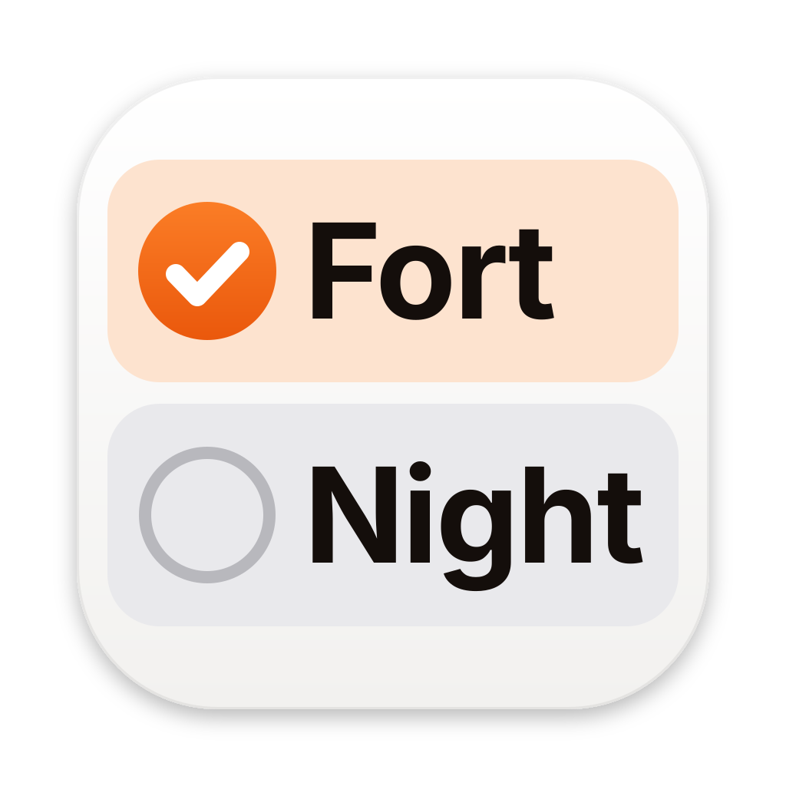
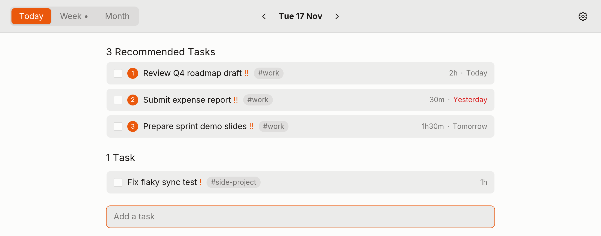

<picture>
  <source media="(prefers-color-scheme: dark)" srcset="assets/icon-dark.svg">
  
</picture>

# Fortnight

Fortnight is a todo app that plans your day and writes your weekly summary for you.

Your tasks and their history stay in one SQLite file on your machine. Fortnight sends that history only to an LLM endpoint you choose, such as a local Ollama. The model writes a summary of your week and picks what to work on next. Nothing else leaves your machine.

> [!NOTE]
> Fortnight is built and tested on macOS. It also builds on Windows and Linux.

<picture>
  <source media="(prefers-color-scheme: dark)" srcset="assets/screenshots/week-dark.png">
  
</picture>

<table>
  <tr>
    <td width="50%"></td>
    <td width="50%"></td>
  </tr>
  <tr>
    <td>Today: recommended tasks, overdue tasks in red, and quick add.</td>
    <td>Month: every task in the month, with the share done on each day.</td>
  </tr>
</table>

## Contents

- [Features](#features)
- [Install](#install)
- [First run](#first-run)
- [Settings](#settings)
- [Where your data lives](#where-your-data-lives)
- [Command line](#command-line)
- [Environment variables](#environment-variables)
- [Project layout](#project-layout)
- [Development](#development)
- [Not included](#not-included)
- [About](#about)
- [License](#license)

## Features

### Three views of your tasks

All three tabs show tasks around one chosen date. `‹` and `›` move back or forward by a day, a week or a month. Today jumps back to the current day.

- **Today** shows one day in four parts:
  - **Tasks.** Recommended tasks are at the top. Below them are the day's tasks and a box to add a task. Overdue tasks are at the bottom, in red. Open tasks from earlier days carry over to today. So do tasks with no planned day, such as ones added from the CLI without a date. Drag a card to change the order.
  - **Notes.** A text box for the day's notes, with bold, italic, links and lists. You can write notes on any day. They go into the weekly summary.
  - **Completed.** The tasks done on that day. If you tick a carried-over or overdue task on today, it moves to today's Completed.
  - **Deleted.** Every deleted task. Each card has Restore and Delete forever. Delete all empties the bin.
- **Week** has a column for each working day. Weekend tasks share one extra column, which shows only when it has tasks. Each column has a load bar:
  - A task with an estimate takes that much time.
  - Tasks without an estimate share the rest of the day.
  - Done tasks show in the accent colour.

  Hover over the bar to see the numbers. A warning sign means the estimates add up to more than the day's hours. Drag a card to another day, or to a new place in its day. The Weekly Summary is under the columns. Click its title to open it.
- **Month** is a calendar. A day with tasks due shows how many are done, such as `67%`. Click the number to list those tasks. Click a day to open it in Today, or a week label to open that week. Done tasks are struck through.

### Quick add

The quick-add bar is always on screen. Type a title, then add any of these:

| Type | Meaning | Examples |
|---|---|---|
| A date | The planned day | `fri`, `tomorrow`, `nov 20`, `+3d` |
| `due:<date>` | The deadline | `due:fri`, `due:nov 20`, `due:+5d`, `due:2026-11-20` |
| `#name` | The project | `#work` |
| `~time` | The estimate | `~2h`, `~30m`, `~1h30m` |
| `!`, `!!` or `!!!` | The priority | `!` is priority 1 |
| `every:<cadence>` | Repeat when completed | `every:daily`, `every:weekdays`, `every:weekly`, `every:monthly` |

For example, `Write Q4 report wed due:fri #work ~2h ! every:weekly` makes a weekly task planned for Wednesday, due Friday, in project `work`, with a two-hour estimate and priority 1. Cards show the priority as marks after the title.

A task has notes, subtasks, an estimate, a priority, a planned day, a deadline, an optional repeat cadence, a private flag (excluded from LLM prompts), and a status: to do, done or deleted. While you type a title or notes, Fortnight suggests a priority. A new task uses the suggestion unless you pick a priority yourself.

### Search and project filter

Press `Cmd+K` / `Ctrl+K`, `/` or click the magnifying glass in the top bar to search across task titles, notes, projects and day notes, filter by `#project`, and jump straight to any result.

### Weekly Summary

Fortnight records every change to every task. The Weekly Summary uses that history and your notes (private tasks are excluded). It says what you finished, what moved forward, which deadlines changed and what is overdue. From its header you can copy it as Markdown, edit it inline, regenerate it, or switch to **Facts** to see the exact deterministic facts sent to the model.

The summary updates by itself:

- When you open the Week tab, Fortnight sends anything that changed since the last update.
- After you edit on the Week tab, it waits 30 seconds, then updates.
- The old summary stays on screen until the new one is ready.
- From 16:00 on your last working day (Friday by default), Fortnight also keeps it up to date in the background. It checks at launch and then every minute. A dot on the Week tab means a new summary is ready.

### Recommended tasks

At the top of the Today tab, Fortnight shows up to three tasks to do first, numbered. It shows fewer, or none, when nothing else is worth doing first.

- On today, it picks from the day's tasks.
- On a later day, it picks only from the tasks planned for that day.
- Overdue tasks are not picked unless you turn on **Recommend overdue tasks** in Settings. Then a picked overdue task shows in Recommended instead of Overdue.
- Rust collects the facts, and the model picks the order. It weighs priority and deadlines.
- The list updates when your tasks change.

### Undo and redo

`Cmd+Z` / `Ctrl+Z` undoes the last add, status change, edit or delete (including any spawned recurring occurrence), and `Shift+Cmd+Z` / `Shift+Ctrl+Z` (or `Ctrl+Y`) redoes it. The notes editor has its own text undo and redo while focused.

### Keyboard

Single keys work when no text field has focus. Press Escape to leave a text field, or `?` at any time to open the in-app shortcut sheet.

| Key | Action |
|---|---|
| `1` `2` `3` | Today, Week, Month |
| `←` `→` | Previous or next day, week or month |
| `T` | Jump to today |
| `N` or `Ctrl/Cmd+N` | Go to the quick-add bar |
| `/` or `Ctrl/Cmd+K` | Search and filter by project |
| `↑` `↓` | Move the selection in Today or Search |
| `Space` | Mark the selected task done or not done |
| `Enter` | Open the selected task to edit it |
| `Ctrl/Cmd+,` | Settings |
| `Ctrl/Cmd+Z` | Undo the last change |
| `Shift+Ctrl/Cmd+Z` | Redo |
| `?` | Keyboard shortcuts |

## Install

There are no ready-made downloads yet. You build Fortnight from source.

1. Install Rust from [rustup.rs](https://rustup.rs). The file `rust-toolchain.toml` sets the Rust version, and rustup installs it on the first build.
2. Install the extra tools for your system:

   | System | Also needs |
   |---|---|
   | macOS | The Xcode command-line tools: `xcode-select --install` |
   | Windows | The [Visual Studio Build Tools](https://visualstudio.microsoft.com/visual-cpp-build-tools/) with the "Desktop development with C++" workload. The built program needs nothing else installed. |
   | Linux | A C compiler. Every desktop install already has the window and graphics libraries the program needs. |

3. Get the code and build it:

   ```sh
   git clone https://github.com/CwbhX/fortnight.git
   cd fortnight
   cargo build --release --locked
   ```

   The first build downloads Rust and every dependency. It takes a few minutes.
4. Start the app:

   ```sh
   ./target/release/Fortnight
   ```

   On Windows, run `target\release\Fortnight.exe`. The command-line tool is `./target/release/fortnight-cli`.

> [!TIP]
> `cargo run --release -p fortnight-app` builds and starts the app in one step.

Your data goes in a `fortnight-data` folder next to the program, here `target/release/fortnight-data`. To keep it somewhere else, start the app with `--data-dir <folder>`. Next, set up the LLM: see [First run](#first-run).

### Fortnight.app on macOS

```sh
cargo xtask bundle              # for this Mac's chip
cargo xtask bundle --universal  # for both Apple Silicon and Intel
```

This builds `target/bundle/Fortnight.app`, which starts without a terminal window. It replaces any older bundle.

- `--universal` needs both Rust targets. Install them with `rustup target add aarch64-apple-darwin x86_64-apple-darwin`.
- The icon is made from `assets/icon-light.svg` with tools that come with macOS. If that step fails, the bundle has no icon.
- You can move `Fortnight.app` anywhere. Keep its data folder next to it.
- `fortnight-cli` is not in the bundle. It uses the folder next to itself, so give it `--data-dir` to share the app's data.

## First run

1. Start the app. Open Settings with the gear icon or `Cmd+,`.
2. In **Model**, choose the provider. Then enter the URL and pick the model; the list fills from the endpoint. If Ollama is running, Fortnight picks it and its first chat model for you.
3. If the endpoint needs a key, paste it and press Save. Then choose a password. The password encrypts the key on disk.
4. Press **Test**.
5. To use a different model for Recommended tasks, tick **Use a different model** in the **Recommendations** block. Then repeat steps 2 to 4 there.
6. Press **Save** at the top of Settings.

To use your keys later, click the lock icon in the top bar and type your password. Click it again to lock. Locking wipes the keys from memory and stops any request that uses one. The app still works while locked; only the LLM features wait.

## Settings

Settings has these parts, from top to bottom:

- **Appearance.** Theme (match the system, light or dark), accent colour, app icon, and the width of the Today tab (Standard, Wide or Extra wide).
- **Model.** The endpoint for everything: provider, URL, model and API key. The provider is Ollama, OpenAI-compatible or Anthropic. Ollama needs no key, so it has no key controls and never asks for a password.
- **Recommendations.** Recommend overdue tasks (off by default). Use a different model, which opens a second endpoint block just for Recommended tasks.
- **Week.** The first day of the week (Sunday by default), the working days, and the work hours per day (8 by default). The load bars use the last two. You can also make new tasks due on the day you add them (off by default).
- **Prompts.** The system prompts for the Weekly Summary and Recommended tasks. They start folded. Reset brings back the built-in prompt.
- **Data folder.** Where your data is, plus one-click Markdown and JSON export into `<data_dir>/exports/`.
- **About.** The app version, author and license.

### Ollama

Fortnight looks for a local Ollama at launch and when Settings opens. It checks `http://localhost:11434/v1`, or the address in `OLLAMA_HOST`. It lists each model with a **thinking** or **decision** tag.

A decision model answers with choices and odds instead of text. It needs Ollama 0.35 or later and uses `/v1/systemone`. You can only pick it for Recommendations. It also suggests task priorities. If it fails, Recommended tasks use the Model endpoint instead.

## Where your data lives

Everything is in one folder, `fortnight-data`, next to the program:

```
anywhere/
├── Fortnight            or Fortnight.exe, or Fortnight.app
└── fortnight-data/
    ├── fortnight.db     tasks, history, reports and settings, in a standard SQLite file
    ├── llm-key          your API key, encrypted, if you set one
    ├── llm-key-decision the Recommendations key, encrypted, if you set one
    └── fortnight.lock   there while the app has the folder open
```

Fortnight picks the folder in this order:

1. `--data-dir <path>`.
2. The `FORTNIGHT_DATA_DIR` environment variable, if it is not empty.
3. `fortnight-data` next to the program. For `Fortnight.app`, the folder goes next to the `.app`, because writing inside a bundle would break its signature.

Fortnight writes nothing outside this folder. To move your data, copy the folder. A folder from an older version opens with nothing lost. Fortnight upgrades the database the first time it opens it.

> [!WARNING]
> If the folder is in a synced place such as Dropbox or iCloud, open it on one machine at a time. The app warns you if it finds a lock from another machine.

The app makes `fortnight.lock` when it starts and removes it when it quits. The CLI never takes the lock, so it can run while the app is open. When the CLI changes the database, the app automatically reloads on window focus or the next minute tick.

### Your API keys

- `llm-key` and `llm-key-decision` hold your API keys. They are sealed with XChaCha20-Poly1305 under a key that Argon2id makes from your password. Someone who copies the data folder can't read them.
- While the app is unlocked, the keys are in memory. Other programs running as you could read them there.
- `fortnight.db` is not encrypted.
- Fortnight sends each key only to its own endpoint. It never sends a key over plain `http` to another machine, and it doesn't follow redirects.
- If your endpoints need no key, as with a local Ollama, Fortnight never makes the key files and never asks for a password.

> [!WARNING]
> There is no way to recover a forgotten password. Remove the keys in Settings and enter them again.

## Command line

`fortnight-cli` works on the same data folder, without a window. `--data-dir <path>` can go anywhere on the line. Only `add` makes a new data folder. The other commands fail if the folder has no database.

```
fortnight-cli add [--private] <words...>        # quick-add syntax: fri, due:fri, +3d, #project, ~2h, !, every:weekly
fortnight-cli list [--all] [--today] [--week] [--project <name>]  # open tasks; --today is Today plus overdue; --all adds done and deleted
fortnight-cli done <id>... [--undo]             # mark tasks done (spawns next occurrence if repeating), or open them again
fortnight-cli edit <id> [--title ...] [--project ...|--clear-project] [--due ...|--clear-due] [--planned ...|--clear-planned] [--estimate ...|--clear-estimate] [--priority 0..3] [--private|--no-private] [--repeat daily|weekdays|weekly|monthly|--clear-repeat]
fortnight-cli delete <id>... [--forever]        # move tasks to Deleted, or remove permanently with --forever
fortnight-cli log [--task <id>] <words...>      # add a note for today (the Today tab's Notes), or a log line on a task
fortnight-cli summary [--week this|last|YYYY-MM-DD] [--facts]   # the weekly summary, streamed
fortnight-cli plan [--facts]                    # recommended tasks for today
fortnight-cli run-due                           # bring the week's summary up to date, then exit
fortnight-cli export [--format md|json] [--out <path>]           # everything, as Markdown or JSON, to the screen or a file
```

- Without `--week`, `summary` covers the latest week whose summary is due.
- `--facts` prints the facts and never calls the LLM. If there is nothing to summarise or recommend, Fortnight doesn't call the LLM and stores nothing.
- `summary`, `plan` and `run-due` take `--protocol openai|anthropic`, `--base-url`, `--model`, `--keyless` and `--password-stdin`. Fortnight assumes a different base URL needs a key unless you also pass `--keyless`.
- For the key, the CLI uses `FORTNIGHT_LLM_API_KEY` if it is set. If not, and a key file exists, and the endpoint is not local or keyless, it asks for the password. With `--password-stdin` it reads the password from standard input.
- `plan` uses the saved Recommendations model. Its key comes from `FORTNIGHT_DECISION_API_KEY` or `llm-key-decision`.
- The CLI stores each report it makes, so the app shows it too.

| Exit code | Meaning |
|---|---|
| 0 | Success. `run-due` with no endpoint makes nothing and also exits 0. |
| 1 | A report failed, a task wasn't found, the folder has no database, the endpoint couldn't be used, or a file couldn't be read or written. |
| 2 | Bad arguments, or no endpoint set up for `summary` or `plan`. |

## Environment variables

| Variable | Meaning |
|---|---|
| `FORTNIGHT_DATA_DIR` | The data folder. `--data-dir` wins over it. |
| `FORTNIGHT_LLM_PROTOCOL` | `openai` or `anthropic`. |
| `FORTNIGHT_LLM_BASE_URL` | The endpoint, such as `http://localhost:11434/v1`. |
| `FORTNIGHT_LLM_MODEL` | The model name. |
| `FORTNIGHT_LLM_KEYLESS` | `1` means the endpoint needs no API key. |
| `FORTNIGHT_LLM_API_KEY` | A key for this run only. Fortnight never writes it to disk. |
| `FORTNIGHT_DECISION_API_KEY` | The same, for the Recommendations model. |

Only the CLI reads the `FORTNIGHT_LLM_*` variables. Its flags win over them, and they win over the saved settings. The app uses its saved settings only.

The app also reads these, for development:

| Variable | Meaning |
|---|---|
| `FORTNIGHT_PAGE` | `today`, `week`, `month` or `settings`: the tab to open. |
| `FORTNIGHT_THEME` | `light` or `dark`, instead of the system theme. |
| `FORTNIGHT_SCREENSHOT` | A file path. The app saves a screenshot of its window there as raw RGBA after two seconds, then quits. `python3 -I tools/raw2png.py <file> out.png` turns it into a PNG. |
| `FORTNIGHT_SCREENSHOT_DELAY` | Seconds to wait before the screenshot, instead of two. |
| `FORTNIGHT_MOTION` | A number from 0 to 1, such as `0.3`. Holds every animation that far along. |

## Project layout

```
crates/
├── fortnight-core/   tasks, storage, the weekly summary and recommendations, LLM clients
├── fortnight-app/    the desktop app (iced), binary Fortnight
└── fortnight-cli/    the command-line tool, binary fortnight-cli
xtask/                builds Fortnight.app (cargo xtask bundle)
assets/               icons, fonts and screenshots
tools/raw2png.py      turns a FORTNIGHT_SCREENSHOT file into a PNG
```

[PLAN.md](PLAN.md) is the first design document. It is kept for history and is not up to date.

## Development

Run these from the repo root before you commit:

```sh
cargo fmt --check
cargo clippy --all-targets -- -D warnings
cargo test
```

- Old data folders must keep opening with nothing lost. `crates/fortnight-core/tests/fixtures/round1.db` is a real old database that the tests open.
- LLM client tests use `wiremock` mock servers, never a real endpoint or key.
- To try the app with sample data, copy `round1.db` to `<scratch folder>/fortnight.db` and run the app with `--data-dir <scratch folder>`.

## Not included

- **Scheduling with the OS**, such as launchd, systemd or Task Scheduler. It would be the only thing Fortnight writes outside its folder. Also, a scheduled job can't type the password for an encrypted key. You can run `fortnight-cli run-due` from your own scheduler, with an endpoint that needs no key or with `FORTNIGHT_LLM_API_KEY` set. Otherwise, Fortnight makes the summary the next time you open and unlock the app.
- **Code signing.** A build you make yourself isn't flagged. If you copy a build to another machine, it shows a one-time Gatekeeper or SmartScreen warning there.
- **Notifications.** Fortnight doesn't send any.

## About

Made by Clement Hathaway ([GitHub](https://github.com/CwbhX)), with [T3 Code](https://t3.codes).

## License

MIT, as set in `Cargo.toml`.
